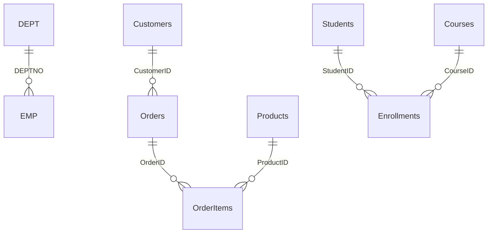

# 구조와 데이터 흐름

공통 설정·제한값과 파일별 코드 정리 내역은 [하드 코딩 점검과 코드 정리](refactoring.md)를 참고하세요.

```mermaid
flowchart LR
  User[React 실습실] --> Editor[QueryEditor]
  Editor --> Hook[useQueryRunner]
  Hook --> API[POST /api/query]
  API --> AllowList[DB ID 검증]
  AllowList --> Lock[DB별 프로세스 및 SQL 잠금]
  Lock --> Connection[새 연결 / 제한 사용자 전환]
  Connection --> Batches[GO 배치 순차 실행]
  Batches --> MSSQL[(실제 Microsoft SQL Server)]
  MSSQL --> Stream[결과 수집 / 행 및 용량 한도]
  Stream --> Cleanup[미완료 트랜잭션 롤백 / 연결 닫기]
  Cleanup --> Results[QueryResults / 메시지 / CSV / JSON]
```

브라우저에는 SQL 접속 정보나 관리자 암호를 전달하지 않습니다. 허용된 DB ID와 작성한 SQL만 API로 보냅니다. SQL 본문을 다른 DB 문법이나 모의 실행기로 변환하지 않으며 GO 구분만 클라이언트 배치 처리로 구현합니다.

## 실습 DB 관계

`컵라면.제조사ID → 제조사.제조사ID`도 FK입니다. exam과 exam_emp의 FK는 처음에는 없고 학습자가 생성합니다. 이름으로 수험번호를 채우는 준비 SQL은 교육용 예제이며 실제 인물 식별에는 고유 키를 사용해야 합니다.

## API

| 메서드 | 경로                          | 역할                                                                  |
| ------ | ----------------------------- | --------------------------------------------------------------------- |
| GET    | `/api/health?database=campus` | 선택 DB의 연결·버전·실행 사용자·작업 상태. 인자가 없으면 전체 DB 확인 |
| GET    | `/api/databases`              | 허용된 DB 3개와 표시 정보                                             |
| GET    | `/api/curriculum`             | 학습 콘텐츠와 교재 메타데이터                                         |
| GET    | `/api/databases/:id/schema`   | 실제 테이블·뷰·열·정확한 타입·PK·FK·기본값·CHECK·행 수                |
| POST   | `/api/query`                  | `{database, sql}` 실행                                                |
| POST   | `/api/setup`                  | `{confirm: "setup"}`으로 없는 실습 DB 준비. 기존 준비 DB 보존         |
| POST   | `/api/databases/:id/reset`    | `{confirm: id}`로 선택 DB의 기본 데이터 복원                          |

실행 응답은 `recordsets`, `rowsAffected`, `messages`, `elapsedMs`, `maxRows`, `maxBytes`, `error`를 포함합니다. SQL 문법·권한 오류는 부분 결과를 유지하기 위해 실행 응답 안에 포함합니다. 잘못된 입력·DB ID는 HTTP 400, 실행 충돌은 409, 연결 실패는 health의 503 등으로 구분합니다.

결과는 `columns[]`와 `rows[][]`로 전달해 중복 열 이름과 이름 없는 열도 보존합니다. JSON/XML의 ODBC 결과도 값으로 정규화합니다. 긴 셀은 임의로 자르지 않으며 용량 한도를 넘는 행을 생략하고 사유를 표시합니다.

스키마 행 수는 `sys.partitions` 기준입니다. 뷰의 행 수는 알 수 없음으로 표시합니다. 정확한 집계는 COUNT로 직접 확인합니다. 열과 FK 조회를 분리해 다중 FK로 인한 열 중복을 방지하며 참조 스키마·테이블·열·CASCADE 동작을 배열로 제공합니다.

## 저장과 복구

`src/lib/storage.js`가 저장값 검증, Web Locks/IndexedDB 잠금, 실패한 변경의 재시도와 탭별 자동 보관을 관리합니다. React는 `useSyncExternalStore`로 이를 구독합니다. 재시도는 다른 탭의 최신 상태에 실패한 변경만 적용하며, 각 탭의 선택 DB는 독립적입니다. 저장 실패가 계속되어도 DB별 최신 SQL만 메모리에 유지합니다.

자동 보관은 별도 키를 사용해 교체 전 SQL과 각 탭의 최근 SQL을 보존합니다. 백업은 현재 메모리 상태와 복구 자료를 포함합니다. 잘못된 항목은 정상 값과 원문을 보존해 복구합니다. 보관이나 저장에 실패하면 이를 알리고 안전하게 재시도할 수 있습니다.

실행·초기화는 프로세스 내부 잠금과 master DB의 public 범위 애플리케이션 잠금을 사용합니다. master의 dbo 권한을 추가로 요구하지 않으며, 별도 프로세스도 같은 DB를 동시에 변경하지 못합니다. 종료 시 세션 잠금을 명시적으로 해제합니다. SQL 입력을 실행하는 연결은 별도로 제한 사용자 전환을 거칩니다.

## 콘텐츠와 PDF 확장

`shared/content/*.mjs`의 항목은 고유 id, 제목, DB, 범주, 종류, 난도, 설명, 정답, 주의사항과 교재 페이지를 갖습니다. setup은 정답을 보여 주지 않고 제공하는 준비 SQL이며 correction은 원본 정정 표시입니다. PDF 외 확장 내용은 빈 pages와 advanced 종류로 구분합니다.

`npm.cmd run pdf:import -- "PDF 절대 경로"`는 원본·추출 텍스트·`shared/source-manifest.json`을 함께 갱신합니다. 먼저 파일을 준비하고 교체에 실패하면 기존 파일을 복원합니다. 실제 페이지 수와 SHA-256을 기록하며, 학습 콘텐츠 기준 교재와 다르면 잘못된 페이지 연결을 막습니다. 새 교재의 문제·해설·정답은 직접 편집하고 검증해야 합니다.
