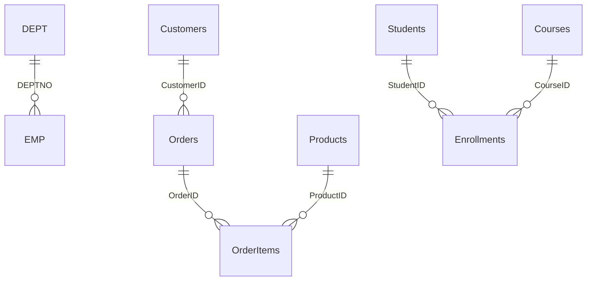

# 구조와 데이터 흐름

```mermaid
flowchart LR
  User[React 실습실] --> Editor[QueryEditor]
  Editor --> Hook[useQueryRunner]
  Hook --> API[POST /api/query]
  API --> AllowList[DB ID 검증]
  AllowList --> Lock[DB별 실행 잠금]
  Lock --> Connection[새 연결 / 제한 사용자 전환]
  Connection --> Batches[GO 배치 순차 실행]
  Batches --> MSSQL[(실제 Microsoft SQL Server)]
  MSSQL --> Stream[결과 스트리밍 / 표시 한도]
  Stream --> Cleanup[미완료 트랜잭션 롤백 / 연결 닫기]
  Cleanup --> Results[QueryResults / 메시지 / CSV]
```

브라우저는 SQL 접속 정보나 관리자 암호를 받지 않습니다. API에 허용된 DB ID와 작성한 SQL만 보냅니다. SQL 본문을 임의의 SQLite 문법이나 정규식 실행기로 변환하지 않습니다. GO 구분만 클라이언트 배치 처리로 구현합니다.

## 실습 DB 관계

`컵라면.제조사ID → 제조사.제조사ID`도 FK입니다. exam과 exam_emp의 FK는 기본 상태에 없고 학습자가 문제 39에서 생성합니다. 수험번호 채우기의 이름 비교는 원본 학습 흐름을 재현하기 위한 예제입니다. 실제 인물 식별에는 고유 키를 사용해야 합니다.

## API

| 메서드 | 경로 | 역할 |
| --- | --- | --- |
| GET | `/api/health` | 실제 SQL 연결·버전·실행 사용자 확인 |
| GET | `/api/databases` | 허용된 DB 3개와 표시 정보 |
| GET | `/api/curriculum` | 71개 학습 콘텐츠와 원본 범위 |
| GET | `/api/databases/:id/schema` | 실제 테이블·뷰·열·PK·FK·행 수 메타데이터 |
| POST | `/api/query` | `{database, sql}` 실행 |
| POST | `/api/databases/:id/reset` | `{confirm: id}`인 선택 DB의 원래 데이터 복원 |

실행 응답은 `recordsets`, `rowsAffected`, `messages`, `elapsedMs`, `maxRows`, `error`를 포함합니다. SQL 문법·권한 오류도 실행 응답 안에 포함해 먼저 생성된 부분 결과와 함께 표시합니다. 유효하지 않은 DB·실행 중 충돌·잘못된 요청은 HTTP 400/409 등으로 반환합니다.

결과는 열 이름만으로 객체를 만들지 않고 `columns[]`와 `rows[][]`로 전달하므로 `SELECT 1 AS x, 2 AS x, 3`도 열을 잃지 않습니다. JSON/XML의 ODBC 청크 결과도 한 셀 값으로 정규화합니다.

스키마 행 수는 `sys.partitions` 메타데이터 기준입니다. 정밀한 집계는 `SELECT COUNT(*)`로 직접 확인할 수 있습니다. 실행·초기화 뒤에는 탐색기 스키마를 다시 요청합니다.

## 콘텐츠 확장

`shared/content/*.mjs`의 각 항목은 고유 `id`, `title`, `database`, `category`, `kind`, `level`, `explanation`, `answer`, `caution`, `pages`를 갖습니다. 필요하면 `setup`에 선행 SQL, `correction`에 원본 정정 표시를 지정합니다. 원본 외 콘텐츠는 `pages: []`, `kind: 'advanced'`로 구분합니다.

새 PDF를 가져오려면 `npm.cmd run pdf:import -- "PDF 절대 경로"`를 사용합니다. 이 명령은 원본·추출 텍스트만 갱신합니다. 교육과정 자동 생성기로 가장하지 않으며, 새 PDF에 맞는 해설·정답·주의사항은 직접 편집하고 통합 검증해야 합니다.
